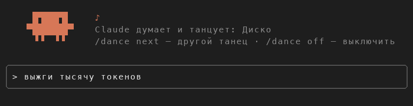
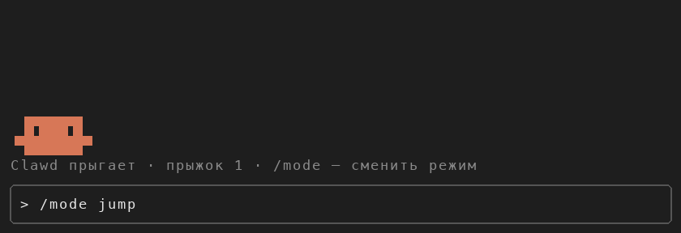

# dance-buddy

Мод для Claude Code: пока Claude работает и думает, над строкой ввода идёт маленькое шоу. Танцует оранжевый Clawd, маскот Claude Code, или он скачет по строке, или по всей ширине терминала мчатся гоночные машины, или Пудж хукает и добивает крипов. Ход закончился, и шоу уходит со сцены.



## Установка

В терминальной сессии Claude Code:

```
/plugin install dance-buddy --marketplace savka43/claude_plugin
```

Ответь `y` на вопрос о маркетплейсе и выбери область установки (Enter — для пользователя).

Из шелла:

```
claude plugin install dance-buddy --marketplace savka43/claude_plugin
```

В десктопном приложении: + рядом с полем ввода → Plugins → Add marketplace `savka43/claude_plugin` → Add plugin.

## Режимы



| Режим | Команда | Что происходит |
|---|---|---|
| Танцы | `/mode dance` | Clawd танцует, танцы ниже |
| Прыжки | `/mode jump` | Clawd скачет по всей строке туда и обратно |
| Гонки | `/mode race` | машина Claude и соперник обгоняют друг друга на дороге во всю ширину терминала |
| Пудж | `/mode pudge` | Пудж кидает хук в крипов, притягивает, добивает и считает ластхиты и золото |

`/mode` или `/mode next` переключает режимы по кругу.

## Танцы

| Танец | Команда |
|---|---|
| Диско | `/dance disco` |
| Робот | `/dance robot` |
| Лунная походка — по всей ширине строки | `/dance moonwalk` |
| Макарена | `/dance macarena` |
| Брейк-данс | `/dance breakdance` |

- `/dance next` — следующий танец
- `/dance random` — случайный танец каждый ход (по умолчанию)
- `/dance claude` — Claude сам выбирает танец под задачу, а иногда придумывает свой
- `/dance off`, `/dance on`, или просто `/dance` — выключить и включить шоу

`/dance <танец>` заодно возвращает режим танцев. Команды `/dance` и `/mode` срабатывают сразу, даже посреди ответа Claude.
